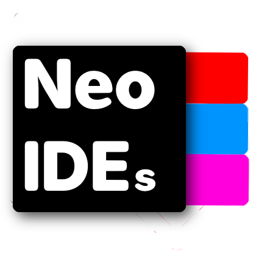

<div align="center">


NeoIDEs

A lightweight, fast, and focused next-generation IDE.
</div>

> [!NOTE]
> This project was completely developed by AI!
> 
> Works on Windows!

<h2 align="center">
Basic Informations
</h2>

<!-- Contents -->
<div align="center">
&emsp;&emsp;One night, LaoDay-114 thought that the IDEs on the market were all too bloated, so he had AI create this project. Of course, the logo was made by hand.

<br>
&emsp;&emsp;Currently supports the following languages:

&emsp;&emsp;1. C
<br>
&emsp;&emsp;2. C++
<br>
&emsp;&emsp;3. C#
<br>
&emsp;&emsp;4. JavaScript
<br>
&emsp;&emsp;5. TypeScript
<br>
&emsp;&emsp;6. Java
<br>
&emsp;&emsp;7. Rust
<br>
&emsp;&emsp;8. CMake
<br>
&emsp;&emsp;9. Python
<br>
&emsp;&emsp;10. Go
<br>
&emsp;&emsp;11. Markdown
<br>
&emsp;&emsp;12. Batch
<br>
&emsp;&emsp;13. Json
<br>
&emsp;&emsp;14. PowerShell
<br>
&emsp;&emsp;15. HTML
<br>
&emsp;&emsp;16. CSS
<br>
&emsp;&emsp;17. XML
<br>
&emsp;&emsp;18. YAML
<br>
&emsp;&emsp;19. SQL
</div>

<h2 align="center">
Download
</h2>

It's simple, just download the latest version from Releases.

<br>
<h2 align="center">
Project Structure
</h2>

<!-- Contents -->
<div align="center">
&emsp;&emsp;Built with C++ 20,Creating a graphical interactive interface using Direct2D and DirectWrite.

<br>
&emsp;&emsp;Project File Introduction:

```Tree
src/    --      The project code is here.
tests/  --      Used for testing syntax highlighting.
build.bat   --  Direct compile.
CMakeLists.txt  --  It's recommended to compile with CMake.
```
</div>
